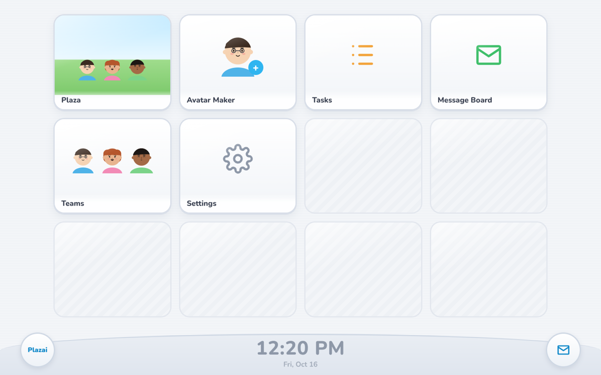
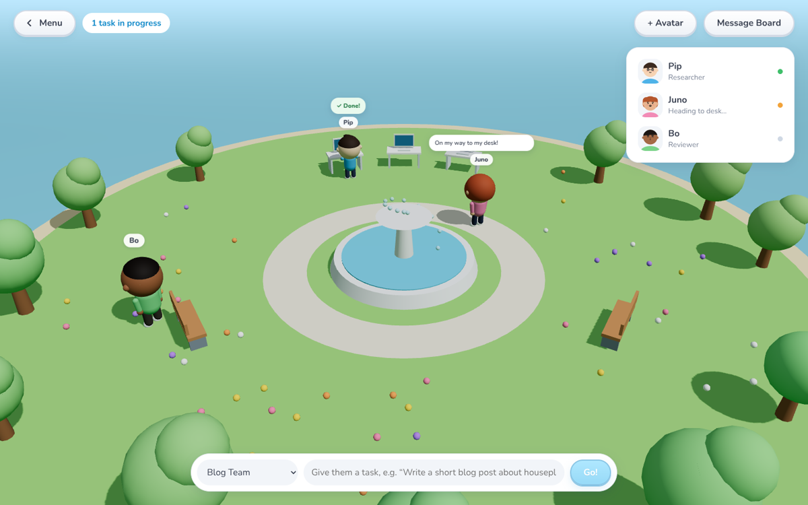
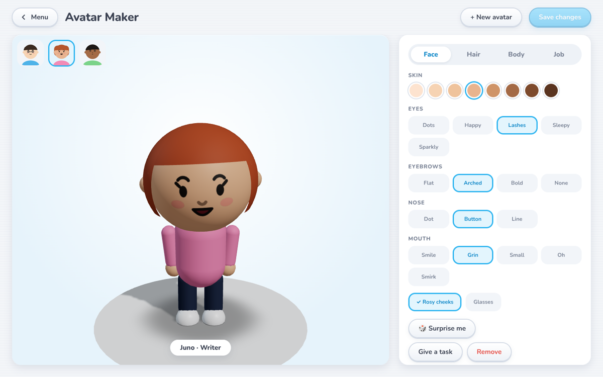
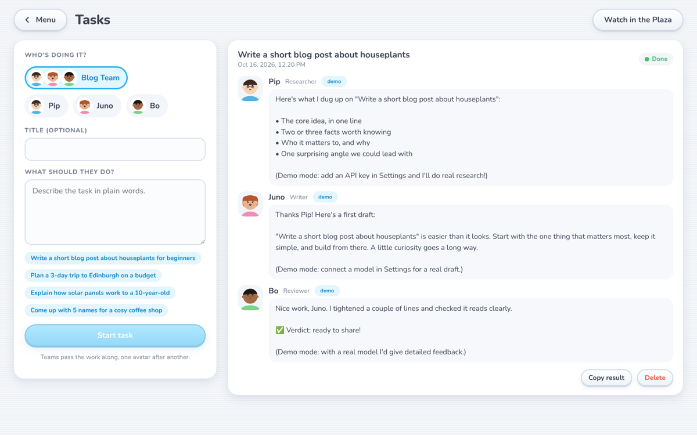
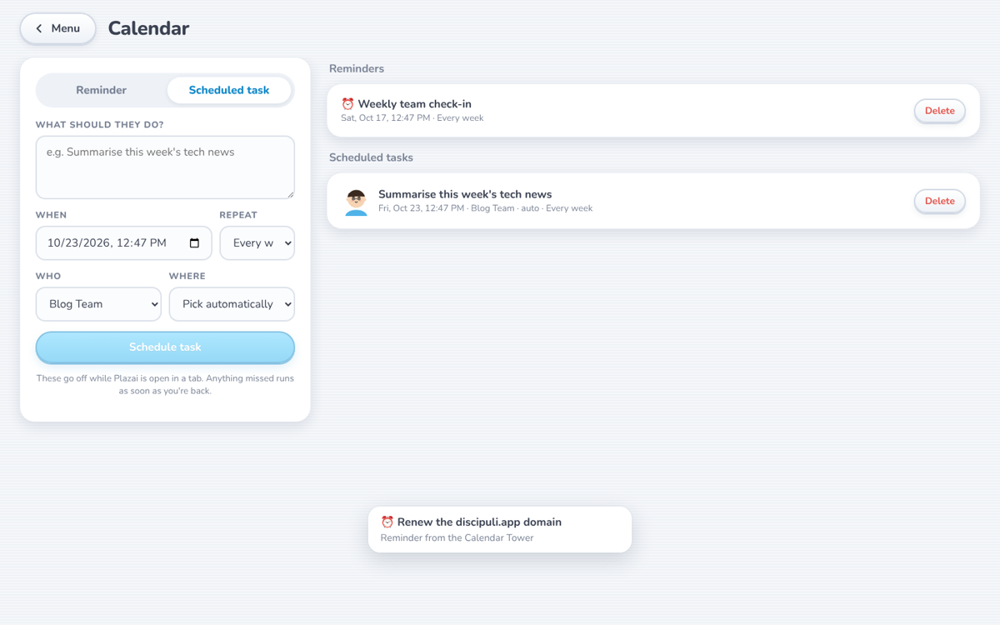

# Plazai

**A cosy plaza where AI agents live.** Design your own avatar agents, give them jobs, and watch them walk to their desks, think out loud and pass work to each other.

Plazai is a small, friendly, open-source take on multi-agent AI. No complicated graphs: make some characters, put them in a team, give them a task.



## Features

- **Avatar Maker:** build characters from faces, hair, body shapes and colours, then give each one a job, a personality and its own instructions.
- **The Plaza:** a 3D island town where your avatars wander, walk into the right building for each job, show their thoughts while they work, and celebrate when they're done.
- **Ten buildings, each with its own expertise:** tasks are routed automatically from their wording, or you pick the place.

  | Building | For |
  | --- | --- |
  | 🖥️ Server Room | Backend: APIs, databases, servers, performance |
  | 📅 Calendar Tower | Reminders, schedules and plans |
  | 🌿 Repo HQ | GitHub: read repos, write changes, upload a branch + pull request or a new repo |
  | 📚 Library | Research, explanations and summaries |
  | ☕ Writers' Café | Blog posts, emails, docs and copy |
  | 🎨 Design Studio | UI/UX, layouts, branding and colour |
  | 🧪 Test Lab | Code review, bugs and tests |
  | 🚀 Launch Pad | Deploys, CI/CD and Docker (the rocket launches when a deploy finishes) |
  | 🔐 Security Vault | Security reviews and hardening |
  | 🔭 Data Observatory | Data, SQL, metrics and charts |

- **Meet your avatars:** click anyone in the Plaza and the camera flies round to face them. They turn and wave, and a card shows their name, role, personality, brain, finished tasks and recent work, with a box to give them a job.
- **Real day and night:** the sky follows your computer's clock, with sunrise, sunset, stars and street lamps. Each avatar has a little house. Half an hour before bedtime they walk home, and at lights out the windows go dark.
- **Bedtime and urgent jobs:** work you give at night is queued and done first thing in the morning. If it can't wait, mark it **⚡ Urgent** and they wake up and run to it. You can set bedtime and wake time (default 22:30 to 07:00), or turn bedtime off, in Settings.
- **Calendar:** reminders and scheduled tasks that can repeat daily, on weekdays or weekly. They go off while Plazai is open, and anything missed runs as soon as you're back.
- **Teams:** line avatars up (Researcher → Writer → Reviewer) and each one builds on the last one's work.
- **Message Board:** finished work lands here, ready to read and copy.
- **Bring any brain:** Google Gemini, Anthropic Claude, OpenAI, or **Ollama** for free, fully local models. Pick a default, or give each avatar its own.
- **Works with no key:** demo mode uses scripted answers, so you can try everything straight away.
- **Private by design:** everything is saved in your browser. Keys only go to the small Plazai server running on your own computer, which refuses requests from other websites.



| Avatar Maker | Tasks | Calendar |
| --- | --- | --- |
|  |  |  |

## Quick start

You need [Node.js](https://nodejs.org) 20 or newer.

```bash
git clone https://github.com/divinadevosai/plazai.git
cd plazai
npm install
npm run dev
```

Open **http://127.0.0.1:5173**. You'll meet Pip, Juno and Bo, the starter Blog Team. Open **Plaza**, type a task and press **Go!**

### Connect a real AI

Open **Settings** and choose a brain:

| Brain | What you need |
| --- | --- |
| Demo | Nothing. Scripted answers. |
| Google Gemini | A key from [Google AI Studio](https://aistudio.google.com/apikey) (has a free tier) |
| Anthropic Claude | A key from the [Anthropic Console](https://console.anthropic.com/settings/keys) |
| OpenAI | A key from the [OpenAI Platform](https://platform.openai.com/api-keys) |
| Ollama | [Ollama](https://ollama.com) running locally, plus a model: `ollama pull llama3.2` |

You can paste keys in Settings (they're kept in your browser's storage) or put them in a `.env` file. See [`.env.example`](.env.example).

### Preview night time

Plazai uses your real clock. To see night without waiting, add `?time=HH:MM` to the address, e.g. `http://127.0.0.1:5173/?time=23:30`. The clock keeps ticking from there.

### Repo HQ and GitHub

Avatars working in Repo HQ read your repository (README and file list) and write complete files. When a task finishes, **Upload to GitHub** lets you pick the files and push them, either as a **new branch with a pull request** on an existing repo or as a **brand-new repo**. Plazai never writes to your default branch, and nothing is uploaded until you click.

Create a [fine-grained token](https://github.com/settings/personal-access-tokens/new) for just the repos you want, with **Contents** and **Pull requests** set to *Read and write* (add **Administration: Read and write** to create new repos). Paste it in **Settings** or set `GITHUB_TOKEN` in `.env`. It's only ever sent to the GitHub API from the Plazai server on your own computer.

## How it works

```
src/
  avatar/     avatar parts, face drawing (2D portraits + 3D face textures), 3D character
  world/      the island, the ten buildings (and where tasks get routed), and the avatars who live there
  engine/     runs tasks (walk to the building → stream the answer → hand off), the scheduler, file parsing
  screens/    home menu, Plaza, Avatar Maker, Tasks, Teams, Message Board, Settings
  store.ts    all app state (Zustand, saved to localStorage)
server/
  api.ts      a tiny Vite plugin: /api/chat streams from the chosen model (Vercel AI SDK);
              /api/github/* reads repos and pushes one commit per upload (branch + PR, or a new repo)
```

A team task runs one avatar at a time. Each avatar gets the task plus everything its teammates handed over, and its answer streams live into the Plaza and the Tasks screen.

## Scripts

| Command | What it does |
| --- | --- |
| `npm run dev` | Run Plazai locally with hot reload |
| `npm run build` | Typecheck and build to `dist/` |
| `npm run preview` | Serve the built app (the API still works) |
| `npm run typecheck` | TypeScript only |

## Contributing

Ideas, bug reports and pull requests are very welcome. See [CONTRIBUTING.md](CONTRIBUTING.md). Some good first issues: more hair styles and outfits, new buildings and props, weather, avatar emotes, and sharing avatars as codes.

## A note on inspiration

Plazai's look is inspired by the friendly, rounded console menus and avatar plazas of the late 2000s. It's an independent project: all characters, art, sounds and code are original, and it isn't affiliated with or endorsed by Nintendo. Please keep contributions original too, with no copied names, logos, characters, sounds or assets from other games or consoles.

## Licence

[MIT](LICENSE) © 2026 Sweeney Creative Co. Created by [swe3we.dev](https://swe3we.dev).
